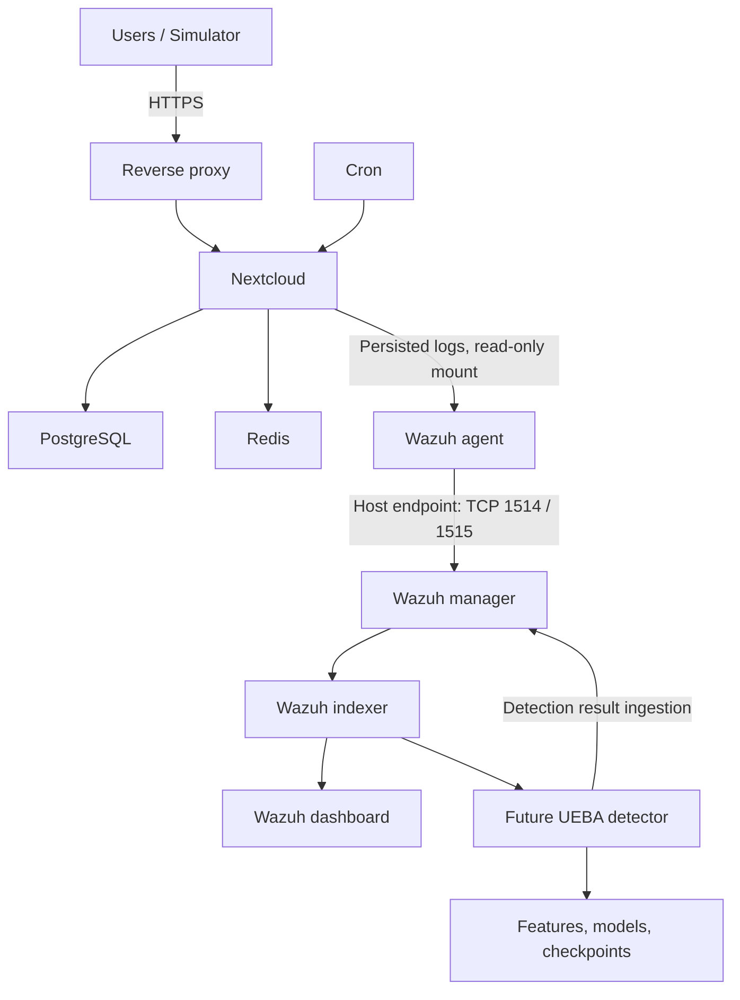

# Product Requirements Document
## Nextcloud UEBA Research Platform

Version: 1.0 — 18 October 2026  
Owner: Raditya Firman Syaputra  
Status: Proposed requirements; implementation and results are not yet verified.

## 1. Purpose and problem

Build a reproducible private-cloud research platform that collects Nextcloud user activity, analyzes behavioral anomalies with Isolation Forest, and presents evidence through Wazuh.

Individual security rules may identify specific events, while behavioral analysis requires activity history, aggregation, and user context. This project will test whether contextual features improve detection under controlled experimental conditions. Improved effectiveness is a research hypothesis, not a guaranteed product outcome.

The platform will support an undergraduate thesis. Landauer et al. (2022) is the research foundation and development direction; published results are not a directly comparable performance baseline.

## 2. Users and outcomes

| User | Need | Expected outcome |
|---|---|---|
| Researcher / administrator | Deploy and operate the environment | Repeatable setup with persistent data and documented configuration |
| Experiment operator | Generate normal and suspicious activity | Repeatable real Nextcloud operations with independent ground truth |
| Analyst / examiner | Inspect findings and evaluate claims | Traceable detections, documented experiments, and reproducible metrics |

## 3. Scope and delivery boundaries

Phase 1 delivers infrastructure, persistent logging, agent enrollment, and operational documentation.

Later releases deliver event normalization, contextual enrichment, simulation, feature engineering, model training, inference, risk scoring, and experimental evaluation.

Out of scope: production high availability, enterprise identity integration, automatic account blocking, proof of malicious intent, and detection of every possible insider threat. No automatic destructive response is required.

## 4. Architecture

Two independent Compose projects are mandatory:

- nextcloud/docker-compose.yml
- siem/docker-compose.yml

There is no shared Docker network between the projects. The Wazuh agent contacts a reachable host IP/domain through published manager ports. Internal networking remains available within each project.

The detection-result ingestion mechanism will be specified before detector implementation. Enrollment port 1515 is distinct from the event-forwarding port 1514.

### Components

| Component | Responsibility |
|---|---|
| Reverse proxy | HTTPS termination and trusted forwarding of client identity |
| Nextcloud | Private storage, user activity, application and audit logs |
| PostgreSQL | Nextcloud metadata and application database |
| Redis | Cache and transactional file locking |
| Cron | Scheduled Nextcloud background tasks |
| Wazuh agent | Read log files and forward events; retain enrollment identity |
| Wazuh manager | Receive events, decode fields, apply rules, and forward configured data |
| Wazuh indexer | Searchable storage for configured events and detections |
| Wazuh dashboard | Event inspection and security visualization |
| Detector, future | Window aggregation, contextual features, inference, risk scoring |

### Connectivity requirements

| Source → destination | Endpoint | Exposure |
|---|---|---|
| Users → reverse proxy | HTTPS 443 | Configured user-facing domain |
| Proxy → Nextcloud | HTTP backend | Restricted to proxy topology |
| Nextcloud → PostgreSQL | TCP 5432 | Nextcloud project only |
| Nextcloud → Redis | TCP 6379 | Nextcloud project only |
| Agent → manager | Host IP/domain:1514 TCP | Published; restrict permitted sources |
| Agent → enrollment | Host IP/domain:1515 TCP | Published; authenticated enrollment |
| Manager → indexer | TCP 9200 | SIEM project only |
| Dashboard → indexer | TCP 9200 | SIEM project only |
| Dashboard → manager API | TCP 55000 | SIEM project only |
| Administrator → dashboard | Configurable HTTPS host port | Restricted administrative access |

These are architecture requirements, not verified deployment settings. The agent must not use localhost or the manager's internal service name. A private reachable host address is suitable; published does not require public internet exposure.

The future detector is initially placed in the SIEM project. Moving it to another host requires a separately secured access design.

## 5. Functional requirements

Priority: Must = required for the indicated release; Should = desirable if practical.

### Phase 1 — Infrastructure

| ID | Priority | Requirement | Acceptance criterion |
|---|---|---|---|
| INF-01 | Must | Maintain two independent Compose files named docker-compose.yml | Both validate; no shared network membership |
| INF-02 | Must | Run Nextcloud, PostgreSQL, Redis, and cron | Services are ready; login and a file upload/download succeed |
| INF-03 | Must | Support a configurable HTTPS domain | Valid TLS access works with documented trusted-domain/proxy settings |
| INF-04 | Must | Persist files, database, configuration, and SIEM state | Safe container recreation preserves a test file, account, and indexed event |
| INF-05 | Must | Run manager, indexer, and dashboard | Services are healthy and dashboard search works |
| INF-06 | Must | Place agent in Nextcloud Compose project | Agent reads intended log mounts without modifying source files |
| INF-07 | Must | Use host-published manager ports | Agent enrolls and connects through configured host endpoint |
| INF-08 | Must | Retain agent identity | Recreation does not require manual registration or create unintended duplicate identities |
| INF-09 | Must | Enable persistent application and audit logging | Controlled actions produce log records at documented paths |
| INF-10 | Must | Configure cron background jobs | Nextcloud reports cron mode and successful scheduled execution |
| INF-11 | Must | Provide safe operational documentation | Start, stop, validation, backup, and restore instructions are included |
| INF-12 | Must | Pin compatible versions and record prerequisites | Version inventory and required host settings are documented |

Phase 1 confirms that logs exist and can be read. Phase 2 proves their collection, searchability, and semantic mapping end to end.

### Phase 2 — Collection, normalization, and context

| ID | Priority | Requirement | Acceptance criterion |
|---|---|---|---|
| LOG-01 | Must | Trace real actions from source to searchable events | Login, upload, download, and failure samples are correlated where supported |
| LOG-02 | Must | Preserve normal activity for behavioral analysis | Known normal actions are searchable through a configured ingestion path |
| LOG-03 | Must | Normalize supported event fields | Timestamp, actor, action, source, outcome, and provenance have documented mappings |
| LOG-04 | Must | Preserve raw evidence and parsing quality | Raw source reference and missing/invalid-field indicators are retained |
| LOG-05 | Must | Handle duplicates and collection lag | Duplicate handling and source-to-index delay are measured |
| CTX-01 | Should | Enrich public IPs with location | Provider/database version, lookup status, and approximate geography are recorded |
| CTX-02 | Must | Handle private or unresolved IPs explicitly | Unknown values remain unknown; no fabricated city or coordinates |
| CTX-03 | Must | Preserve trustworthy client IP | Trusted proxy configuration passes a controlled client-IP verification |

City/region lookup is enrichment, not proof of a user's physical location. VPNs, proxies, NAT, and missing data limit interpretation.

### Phases 3–7 — Simulation, analytics, and evaluation

| ID | Priority | Requirement | Acceptance criterion |
|---|---|---|---|
| SIM-01 | Must | Execute real Nextcloud operations | Scripts create verifiable activity through supported interfaces |
| SIM-02 | Must | Generate varied normal workloads | Users have documented behavioral profiles and legitimate bursts |
| SIM-03 | Must | Generate controlled suspicious scenarios | Mass download, mass upload, and broad file access are repeatable |
| SIM-04 | Must | Store independent ground truth | Run IDs, users, scenario periods, actions, and execution outcomes are recorded separately |
| SIM-05 | Must | Distinguish attempted from successful activity | Failed operations are recorded and not counted as completed attacks |
| FE-01 | Must | Aggregate by user and configurable time window | Identical input/configuration produces identical feature rows |
| FE-02 | Must | Build features from observable data | Each feature has a definition, source, missing-value policy, and availability check |
| FE-03 | Must | Use historical context without future leakage | Baselines for a window use only information available by scoring time |
| ML-01 | Must | Train Isolation Forest on designated normal training data | Model, feature schema, seed, and configuration are saved |
| ML-02 | Must | Calibrate threshold on separate validation data | Threshold choice is recorded before final test evaluation |
| ML-03 | Must | Freeze evaluation artifacts | Test labels and test outcomes do not alter the fitted model or threshold |
| RISK-01 | Must | Implement a documented contextual scoring layer | Inputs, normalization, weights, and missing-data handling are explicit |
| DET-01 | Must | Produce traceable detections | Each result identifies user, window, model version, scores, and supporting context |
| DET-02 | Must | Resume processing safely | Checkpoints prevent unintended repeated results after restart |
| UI-01 | Must | Inspect results in Wazuh | Analyst can find detections and related activity |
| EVAL-01 | Must | Compare basic and contextual feature configurations | Same splits, scenario set, and evaluation unit are used |
| EVAL-02 | Must | Assess the separate effect of risk scoring | Before/after alert policies are compared without test-set tuning |
| EVAL-03 | Must | Export reproducible results | Metrics, run manifests, settings, and experiment limitations are saved |

## 6. Data requirements

### Normalized event contract

Required where observable: event timestamp in UTC, ingestion timestamp, source system, source event/request identifier, user identifier, action, outcome, client IP, file/resource reference, and raw-event provenance.

Optional fields: user agent, session identifier, response code, bytes transferred, country, region, city, coordinates, and enrichment status. Missing values must not be silently interpreted as zero or normal behavior.

Retain local timezone information for behavioral context. Store credentials, tokens, and file contents outside analytics datasets. Use synthetic identities and non-sensitive test files.

### Feature candidates

- Activity volume: operation counts by action and total operations.
- Breadth: distinct files, paths, and source IPs.
- Outcomes: failed logins and failed-operation ratios.
- Transfer behavior: byte totals only if actual logs provide verified measurements.
- Time context: hour/day, off-profile activity, and activity rate.
- Historical novelty: new source IP and changes from prior user behavior.
- Location context: geography novelty where reliable observations exist.

Do not submit labels, scenario IDs, attack flags, or other simulator-only knowledge as model features. Treat arbitrary user IDs and raw IP encodings carefully to avoid memorization artifacts.

### Detection record

Include detection ID, user, window start/end, model/feature version, raw anomaly score, score direction, threshold, contextual evidence, final risk value, severity, creation time, and source-event references.

An anomaly indicates unusual behavior. It does not by itself establish malicious intent, insider threat, or account compromise.

## 7. Experimental requirements

Define the primary evaluation unit before experiments: user-window is the proposed default. Specify how an attack overlapping a window labels that window. Report event-level or episode-level findings separately.

Use chronological training, validation, and test partitions. Fit preprocessing and historical baselines without test-data leakage. Document dataset size, user count, duration, activity distributions, and scenario repetitions before final collection; these quantities remain to be decided.

Proposed comparisons:
1. Isolation Forest with basic activity features.
2. Isolation Forest with additional contextual features.
3. Contextual model with a separately documented risk-scoring alert policy.

Report precision, recall/TPR, F1, false-positive rate, and confusion matrix. Also report false alerts per user-day and episode detection delay when measurable. State denominators, class balance, undefined metric cases, and the effect of the aggregation window.

Define episode detection delay from the first successful suspicious operation to the first qualifying detection. Report missed episodes separately. Repeat scenarios using recorded seeds and configurations; report variability.

No minimum accuracy or recall is promised. The research outcome may show improvements, tradeoffs, or no measurable benefit.

## 8. Nonfunctional requirements

- Reproducibility: pinned dependencies, versioned configuration, deterministic seeds where applicable, and experiment manifests.
- Reliability: persistent state, meaningful health checks, runtime retry behavior, and documented recovery.
- Security: authenticated enrollment, protected credentials, restricted published endpoints, TLS where applicable, and read-only log access.
- Resource control: documented hardware, retention settings, indexing growth, processing lag, and detector resource use.
- Observability: visible service failures, parser failures, missing logs, and detector processing progress.
- Maintainability: configuration examples, clear component boundaries, and documented schema/version changes.
- Data preservation: no volume deletion, database reset, or destructive migration during normal deployment.
- Privacy: synthetic accounts and files; avoid collecting unnecessary personal information.

Latency and resource budgets will be set after a baseline measurement on the actual thesis hardware. Until then, measured latency and throughput must be reported rather than described as guaranteed real time.

## 9. Milestones and release gates

| Milestone | Deliverable | Release gate |
|---|---|---|
| M1: Environment | Two Compose stacks and documentation | Phase 1 infrastructure acceptance checks pass |
| M2: Data pipeline | Mapped and searchable real activity | Normal and suspicious-action samples traced end to end |
| M3: Simulator | Workloads and independent truth manifests | Repeated runs produce expected verified operations |
| M4: Feature pipeline | Versioned user-window dataset | Feature correctness and leakage checks pass |
| M5: Model | Trained model and fixed threshold | Reproducible validation completed |
| M6: Integration | Searchable detection records | End-to-end controlled scenario produces traceable results |
| M7: Evaluation | Comparison tables and thesis evidence | Frozen-test evaluation and limitations documented |

## 10. Phase 1 verification checklist

- Both docker-compose.yml files pass configuration validation without leaking secrets.
- Nextcloud and its database/cache dependencies start successfully.
- HTTPS domain and trusted proxy settings match deployment.
- Upload/download and cron execution succeed.
- Audit/application logs persist and agent mounts are readable.
- Agent enrolls and connects through host-published ports.
- Docker inspection confirms no shared network between projects.
- Manager, indexer, and dashboard are healthy.
- Container recreation preserves data and agent identity.
- Backup/restore steps and unexecuted checks are clearly documented.

## 11. Risks and mitigations

| Risk | Mitigation |
|---|---|
| Logs omit actions, identity, or transfer sizes | Verify actual samples before finalizing features; add justified access-log sources |
| Only alert events reach detector | Explicitly configure normal-event retention and shipping/indexing |
| Synthetic workloads are overly simple | Add benign bursts, user variation, and repeated scenarios; limit generalization claims |
| Proxy hides or spoofs source identity | Configure trusted forwarding and test end-to-end client IP |
| GeoIP misrepresents location | Record uncertainty; handle private IPs; avoid treating geography as proof |
| Cross-stack endpoint is unreachable | Verify from inside agent container and document firewall/routing |
| Index storage or memory is exhausted | Measure growth and set scoped collection and retention |
| Restart duplicates windows or detections | Persist checkpoints and use stable detection IDs |
| Test-set tuning overstates performance | Freeze splits, model, threshold, and scoring policy before final evaluation |

## 12. Decisions pending

- Actual host OS, CPU, RAM, disk, and whether deployment uses one or two hosts.
- Nextcloud domain, reverse-proxy placement, and TLS provision.
- Reachable manager address and permitted agent source addresses.
- Compatible pinned image versions, verified against official documentation during implementation.
- Available log fields and exact collection/indexing configuration.
- Simulator users, duration, volumes, and scenario repetition counts.
- Window duration, history warm-up, geographic data source, retention, and latency targets.
- Final risk-scoring formula and detector-to-Wazuh ingestion mechanism.

This PRD defines intended behavior. It does not certify deployed software compatibility or claim that any environment or experiment has already passed validation.

